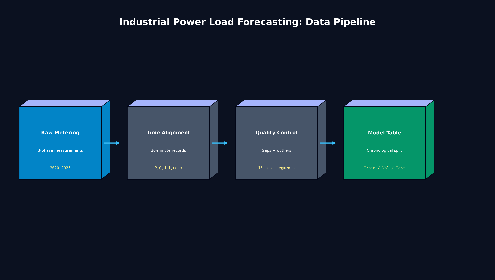
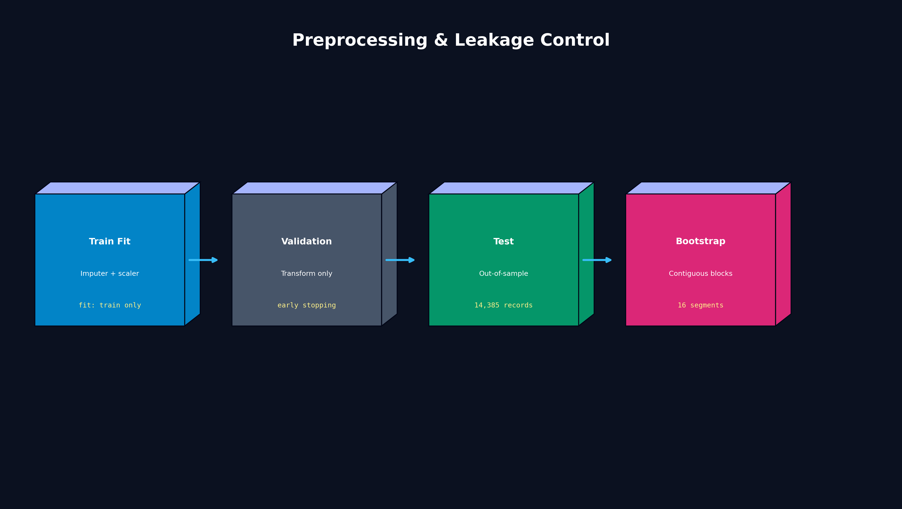
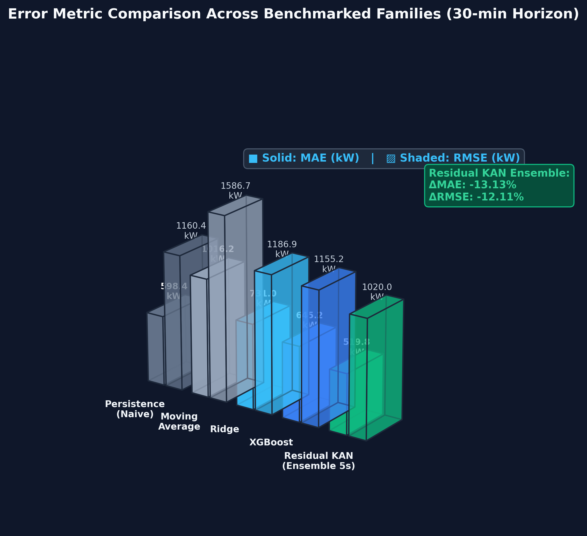
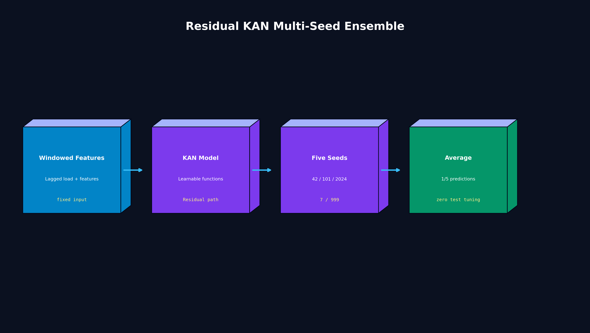
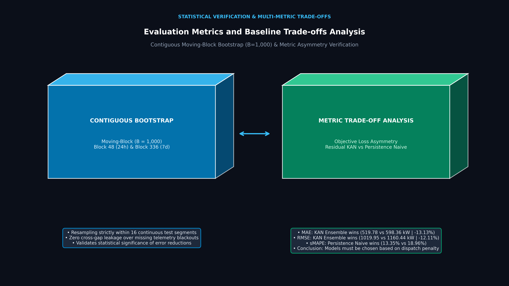

# Industrial Power Load Forecasting Platform

[](https://www.python.org/)
[](https://pytorch.org/)
[](https://huggingface.co/neitpm/power-load-forecasting)
[](LICENSE)
[]()
[]()

Industrial short-term (30-minute horizon, single-step ahead) electric power load forecasting platform deployed on five years (2020–2025) of three-phase telemetry records from **Tay Ninh Power Company (PC Tây Ninh)**.

The platform implements a **Residual Kolmogorov–Arnold Network (KAN)** with target normalization, benchmarked against six classical machine learning and heuristic baseline families across **14,385 out-of-sample test samples** with strict temporal leakage control.

---

## 🏛️ 1. Project Overview & System Architecture

```text
Raw Metering CSV (30-min intervals)
      ↓
Timestamp Alignment & 30-min Step Regularization
      ↓
Outlier Filtering & Continuous Segment Partitioning (16 Segments)
      ↓
Lag & Cyclical Temporal Feature Engineering
      ↓
Train-only Imputer & Scaler Fitting (Zero Leakage)
      ↓
Chronological Split [Train (2020-01/2024) | Val (01/2024-11/2024) | Test (11/2024-08/2025)]
      ↓
Model Benchmarking (Baselines vs Residual KAN Ensemble)
```

The system targets active power $P\text{ (kW)}$ prediction 30 minutes in advance. Rather than predicting raw magnitude directly, the core model employs **Residual Learning** ($\hat{P}_{t+1} = P_t + \text{KAN}(X)$) to forecast load increments ($\Delta P$), bypassing numerical instability and enabling rapid convergence.



---

## 📊 2. Industrial Telemetry Dataset Specification

Data originates from the telemetry/AMR system at **Feeder 480, Substation 224 Tan Hung (Tay Ninh Power Company)**:

| Attribute | Specification |
| :--- | :--- |
| **Grid Entity** | Feeder 480, 110kV/22kV Substation 224 Tan Hung (Tay Ninh Power Co.) |
| **Sampling Interval** | 30 minutes fixed ($\Delta t = 30\text{ min}$) |
| **Monitored Variables** | Three-phase voltages ($U_A, U_B, U_C$), currents ($I_A, I_B, I_C$), power factor ($\cos\varphi$), active power ($P\text{ kW}$), reactive power ($Q\text{ kVAr}$) |
| **Full Date Span** | March 2020 to August 2025 (5+ years of continuous operations) |
| **Train Period** | 2020-03-01 to 2024-01-15 (Fitted imputer, scalers, and model weights) |
| **Validation Period** | 2024-01-15 to 2024-11-02 (Early stopping and hyperparameter monitoring) |
| **Out-of-Sample Test Period** | `2024-11-02 15:30:00` to `2025-08-30 23:30:00` |
| **Evaluated Test Records** | **14,385 valid records** |
| **Segment Partitioning** | **16 continuous time segments** (Bootstrap resampling strictly respects segment boundaries) |

---

## 🛡️ 3. Preprocessing Contract & Zero Data Leakage

To prevent optimistic bias and temporal leakage, all transformations strictly follow out-of-sample segregation:



1. **Chronological Splitting**: Train, Validation, and Test splits are ordered chronologically without random shuffling.
2. **Train-Only Parameter Fitting**:
   - `SimpleImputer` (median strategy) and `StandardScaler` are fitted **strictly on the training split** (`2020-03-01` to `2024-01-15`).
   - Validation and Test splits are transformed using stored parameters ($\mu_{\text{train}}, \sigma_{\text{train}}$) without re-estimation.
3. **Continuous Segment Integrity**: Missing steps and telemetry blackouts are detected to divide the test set into 16 continuous time segments; moving-block bootstrap evaluations never cross segment boundaries.
4. **Target Normalization & Residual Formulation**: Mean power is approximately $8,240\text{ kW}$. Target scaling prevents gradient explosions during B-spline activation optimization.

---

## 🧠 4. Model Architecture: Residual KAN Regressor

Built directly in [`code/models_kan.py`](file:///code/models_kan.py), the architecture replaces traditional fixed MLP activations with learnable spline functions placed on graph edges:

```text
Input Features X [Lagged P, U, I, Temporal Encodings]
      │
      ├───[ Skip Connection ]─────────────────────────────┐
      │                                                   │
      ▼                                                   ▼
[ KAN Layer 1 ] (KANLinear: 5-Grid, Spline Order 3)     Base P_t (scaled)
      │
      ▼
[ LayerNorm + Dropout (0.05) ]
      │
      ▼
[ KAN Layer 2 ] (KANLinear: 64 -> 32)
      │
      ▼
[ Output Projection ] -> Residual Increment ΔP
      │                                                   │
      └─────────────────────► [ + ] ◄─────────────────────┘
                               │
                               ▼
                       ŷ_scaled = P_t + ΔP
                               │
                               ▼
                     Inverse Target Scaler
                               │
                               ▼
                    Predicted Power P (kW)
```

- **`KANLinear`**: Implements B-spline bases with order $k=3$ and grid size $G=5$ alongside a SiLU base transformation.
- **Residual Formulation**: $\hat{y} = P_t + \text{KAN}(X)$ forces the network to learn only local volatility rather than reconstruct baseline power levels.

---

## ⚖️ 5. Benchmarked Baseline Models

The framework compares against six baseline families across naive heuristics, statistical aggregators, and tree-based ensembles:

1. **Persistence Naive ($P_t$)**: Direct carry-forward $\hat{P}_{t+1} = P_t$. Standard industrial benchmark for short-horizon forecasting.
2. **Seasonal Naive 24h ($\text{lag}_{48}$)**: Carries forward the reading from exactly 24 hours prior (48 steps).
3. **Seasonal Naive 7d ($\text{lag}_{336}$)**: Carries forward the reading from 7 days prior (336 steps).
4. **Moving Average (1.5h)**: Uniform average over the preceding 3 steps ($t, t-1, t-2$).
5. **Ridge Regression**: Regularized linear model fitted on full lag and meteorological/temporal features.
6. **XGBoost Regressor**: Gradient-boosted decision trees with depth regularization.
7. **HistGradientBoosting Regressor**: Histogram-based decision tree ensemble.



---

## 🎯 6. Multi-Seed Stability & Uniform Ensemble

Neural network random initialization can skew reported time-series metrics. To guarantee scientific repeatability, the Residual KAN was trained across **5 independent seeds**: `[42, 101, 2024, 7, 999]`.



- **Single Model Stability**: Across the 5 seeds, the model converged consistently with low dispersion:
  $$\text{MAE} = 528.99 \pm 12.23\text{ kW}, \quad \text{RMSE} = 1033.35 \pm 13.78\text{ kW}$$
- **Uniform Simple Ensemble**:
  $$\hat{y}_{\text{ensemble}} = \frac{1}{5} \sum_{i=1}^5 \hat{y}_i$$
  Weights are uniformly fixed at $w_i = 0.2$ without any post-hoc optimization on test data (Zero Test Leakage).

---

## 📈 7. Master Benchmark Results

All metrics below are computed on the identical out-of-sample test set (**14,385 samples**, Feeder 480):

$$\Delta\text{Metric (\%)} = \frac{\text{Metric}_{\text{Persistence}} - \text{Metric}_{\text{Model}}}{\text{Metric}_{\text{Persistence}}} \times 100\%$$

| Family | Model | MAE (kW) | RMSE (kW) | sMAPE (%) | $R^2$ Score | $\Delta\text{MAE vs Persist}$ | $\Delta\text{RMSE vs Persist}$ |
| :--- | :--- | :---: | :---: | :---: | :---: | :---: | :---: |
| **Naive Baseline** | 1. Persistence Naive ($P_{t}$) | 598.36 | 1160.44 | **13.35%** | 0.8770 | Baseline (0.00%) | Baseline (0.00%) |
| **Naive Baseline** | 2. Seasonal Naive 24h ($\text{lag}_{48}$) | 1363.07 | 2495.50 | 30.41% | 0.4313 | -127.80% | -115.05% |
| **Naive Baseline** | 3. Seasonal Naive 7d ($\text{lag}_{336}$) | 1882.99 | 3123.69 | 42.54% | 0.1090 | -214.69% | -169.18% |
| **Naive Baseline** | 4. Moving Average (1.5h) | 1016.16 | 1586.70 | 21.74% | 0.7701 | -69.82% | -36.73% |
| **Classical ML** | 5. Ridge Regression | 730.96 | 1186.89 | 24.73% | 0.8714 | -22.16% | -2.28% |
| **Classical ML** | 6. XGBoost Regressor | 645.24 | 1155.21 | 23.30% | 0.8781 | -7.83% | +0.45% |
| **Classical ML** | 7. HistGradientBoosting Regressor | 648.01 | 1153.06 | 23.41% | 0.8786 | -8.30% | +0.64% |
| **Multi-seed Stability** | 8. Residual KAN Single (Mean $\pm$ Std)* | 528.99 $\pm$ 12.23 | 1033.35 $\pm$ 13.78 | 19.17% $\pm$ 0.32% | 0.9025 $\pm$ 0.0026 | +11.59% | +10.95% |
| **Proposed Model** | 9. **Residual KAN Ensemble (5 Seeds)\*\*** | **519.78** | **1019.95** | 18.96% | **0.9050** | **+13.13%** | **+12.11%** |

> **Scientific Evaluation Takeaway:**
> The Residual KAN ensemble reduced absolute and squared error ($\text{MAE} -13.13\%$, $\text{RMSE} -12.11\%$, $R^2 = 0.9050$), but did not dominate the persistence baseline on every metric (**Persistence Naive remained superior on sMAPE at 13.35%**). This result highlights the critical importance of evaluating short-horizon load forecasting models against strong naive baselines.



---

## 🔬 8. Statistical Significance: Contiguous Moving-Block Bootstrap

To test whether performance differences are statistically meaningful on autocorrelated time series, a **Contiguous Moving-Block Bootstrap** ($B = 1,000$ iterations) was applied across block sizes 48 (24 hours) and 336 (7 days) without crossing telemetry gap boundaries. Detailed metrics are available in [`output_preprocessing/reports/moving_block_bootstrap_summary.json`](file:///output_preprocessing/reports/moving_block_bootstrap_summary.json).

---

## 📦 9. Hugging Face Hub Artifacts & Verification

All reproducible artifacts, benchmark reports, and validation manifests are officially published and indexed on Hugging Face Hub:

👉 **Hugging Face Model Hub**: [**https://huggingface.co/neitpm/power-load-forecasting**](https://huggingface.co/neitpm/power-load-forecasting)

### Published Artifacts List

| Relative Path | Size | Description |
| :--- | :---: | :--- |
| `code/models_kan.py` | 16.7 KB | Residual KAN Regressor PyTorch architecture definition |
| `code/power_load_preprocessing_pipeline.py` | 40.2 KB | Zero-leakage chronological preprocessing pipeline |
| `code/kan_multi_seed_benchmark.py` | 15.9 KB | 5-seed training stability and uniform ensembling runner |
| `code/temporal_significance_test.py` | 15.7 KB | Contiguous moving-block bootstrap statistical module |
| `code/train_baseline_models.py` | 20.7 KB | Heuristic and classical ML baselines evaluation suite |
| `code/generate_master_benchmark.py` | 8.4 KB | Master benchmark consolidation and markdown table generator |
| `code/visualize_3d_architecture.py` | 20.2 KB | 3D isometric architecture figures generator (300 DPI) |
| `reports/master_model_comparison_benchmark.md` | 4.5 KB | Consolidated master benchmark markdown report |
| `reports/moving_block_bootstrap_summary.json` | 2.4 KB | Block 48/336 contiguous bootstrap test results |
| `metadata/weights_manifest.json` | 2.5 KB | Integrity manifest containing SHA-256 hashes for all artifacts |
| `requirements.txt` | 192 B | Minimal pinned dependency requirements |

> **Privacy & Compliance Note:**
> In compliance with enterprise data governance regulations of **Tay Ninh Power Company**, the proprietary 5-year raw industrial metering dataset is **not publicly uploaded** to the repository or Hugging Face Hub. Users can execute the preprocessing and modeling pipeline on their own standard 3-phase metering CSV files.

### Download & Verification with `huggingface_hub`

You can download the full release snapshot and verify SHA-256 integrity using the Python script below:

```python
from huggingface_hub import snapshot_download

# Download verified release snapshot
snapshot_dir = snapshot_download(repo_id="neitpm/power-load-forecasting")
print(f"Snapshot downloaded to: {snapshot_dir}")
```

To run the automated SHA-256 integrity check and forward-pass smoke test:

```bash
# Automated independent verification
python verify_hf.py
```

---

## 💻 10. Reproducibility & CLI Execution

### Environment Setup
```bash
git clone https://github.com/neitpm/power-load-forecasting.git
cd power-load-forecasting
pip install -r requirements.txt
```

### End-to-End Pipeline Reproduction
```bash
# 1. Format raw telemetry files into standardized wide CSVs
python code/batch_format_power_csvs.py --input_dir "datasets/Tan Hung/Tan Hung/224/2024" --out_dir "formatted_out" --freq 30min

# 2. Execute zero-leakage preprocessing, segment extraction, and feature caching
python code/power_load_preprocessing_pipeline.py

# 3. Train and evaluate all heuristic and classical ML baselines
python code/train_baseline_models.py

# 4. Train multi-seed Residual KAN models and compute ensemble statistics
python code/kan_multi_seed_benchmark.py

# 5. Compile consolidated benchmark markdown and JSON reports
python code/generate_master_benchmark.py

# 6. Generate 300 DPI 3D architecture diagrams
python code/visualize_3d_architecture.py
```

---

## ⚠️ 11. Limitations & Deployment Scope

1. **Spatial Generalization**: Results are verified specifically for Feeder 480 at Substation 224 Tan Hung. Transferability to other feeders or topologies requires site-specific revalidation.
2. **Point Forecasting Horizon**: The current system provides point forecasts ($\hat{P}$), not probabilistic prediction intervals.
3. **sMAPE Trade-Off**: Persistence Naive remains superior in sMAPE, making pure metric selection dependent on downstream grid dispatch cost structures.
4. **Production Integration**: This repository serves as a scientific benchmark and reproducible research artifact; real-time streaming inference requires upstream SCADA/AMR connector daemons.
